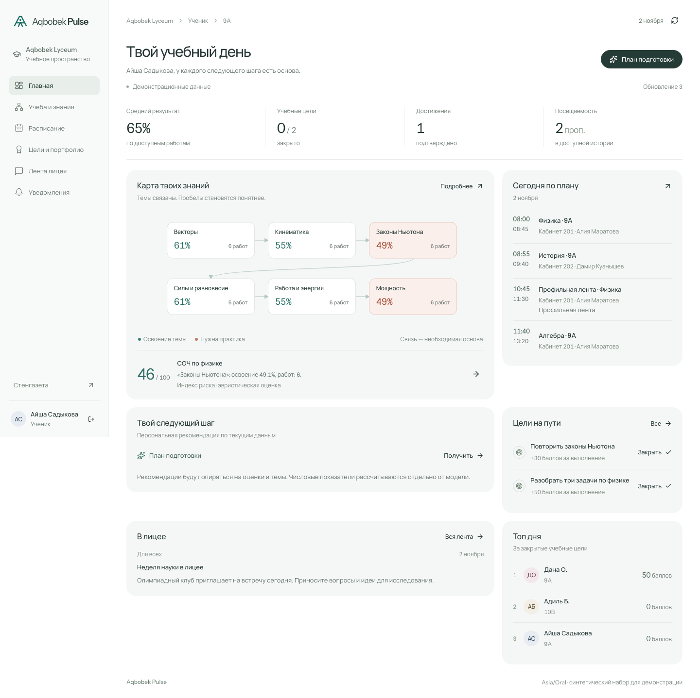
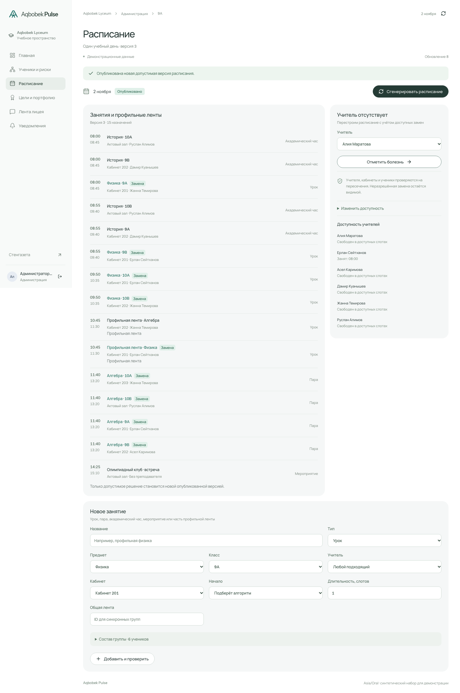
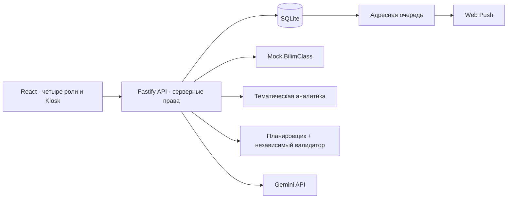

<div align="center">

# Aqbobek Pulse

**Учебные сигналы, достижения и расписание — в одном школьном портале.**

Прототип для кейса Aqbobek Lyceum · AIS Hack 3.0

[Быстрый старт](#быстрый-старт) · [Демо за 2 минуты](docs/DEMO.md) · [Проверки](docs/VALIDATION.md) · [Ограничения](docs/LIMITATIONS.md)


</div>



Aqbobek Pulse связывает оценки с учебными темами, помогает заметить падение успеваемости и пересчитывает расписание при отсутствии учителя. У ученика, родителя, учителя и администрации — собственные представления общих данных.

> Все данные демонстрации синтетические. Это независимый хакатонный прототип: реальная интеграция BilimClass и точность прогнозирования на школьных данных не заявляются.

## Что умеет портал

| Задача | Решение | Реализация |
|---|---|---|
| Понять, какие темы требуют внимания | Персональная карта знаний, освоение тем и объяснимый индекс риска | [Аналитика](server/analytics/index.ts) |
| Получить следующий шаг в подготовке | AI-тьютор с материалами из проверенного каталога | [AI-модуль](server/ai/index.ts) |
| Раньше заметить падение успеваемости | EWS по предметам и отчёт класса | [API и права](server/app.ts) |
| Следить за прогрессом ребёнка | Доступ к своему ребёнку и недельная выжимка | [Ролевые представления](server/projections.ts) |
| Собирать подтверждённые достижения | Портфолио, очередь проверки, цели и рейтинг дня | [Интерфейс](client/App.tsx) |
| Перестроить сложное расписание | Группы, синхронные ленты, пары, доступность учителей и кабинетов | [Планировщик и валидатор](server/schedule/index.ts) |
| Узнать об изменениях | Адресные сообщения, Web Push и автономная стенгазета | [Уведомления](server/notifications/index.ts) |

## Быстрый старт

Нужны **Node.js 26+**, npm и доступный для записи локальный каталог. В проверенном окружении использовались Node 26.8.1 и npm 11.19.0.

```sh
npm ci
npm run build
npm start
```

После запуска: [портал — localhost:3001](http://localhost:3001) · [стенгазета — /kiosk](http://localhost:3001/kiosk).

Без API-ключа приложение работает на синтетическом mock-сервере и показывает явно помеченные фактические шаблоны. Для разработки доступен `npm run dev`.

### Демонстрационные роли

Пароль локальных демо-аккаунтов: **`Pulse2026!`**. Это открытые тестовые учётные записи, не доступ к реальной школе.

| Учётная запись | Роль |
|---|---|
| `student9@pulse.demo` | Ученик 9-го класса |
| `student10@pulse.demo` | Ученик 10-го класса |
| `teacher@pulse.demo` | Учитель |
| `substitute@pulse.demo` | Заменяющий учитель |
| `parent@pulse.demo` | Родитель |
| `admin@pulse.demo` | Администрация |

Ограничения доступа применяются на сервере: родитель видит связанного ребёнка, учитель — назначенные классы и предметы.

### Настройка AI

Создайте локальный `.env` по образцу [.env.example](.env.example). Значения секретов в репозитории отсутствуют.

| Переменная | Назначение |
|---|---|
| `GEMINI_API_KEY` | Ключ Gemini API, только на сервере |
| `GEMINI_MODEL` | Модель, доступная вашему аккаунту |
| `PORT` / `HOST` | Адрес сервера; по умолчанию `3001` / `127.0.0.1` |
| `APP_ORIGIN` | Точный origin приложения; для удалённого размещения нужен HTTPS |
| `DATABASE_PATH` | Необязательный путь SQLite; по умолчанию `data/pulse.sqlite` |

После изменения конфигурации перезапустите сервер. Текстовый ответ помечается как `live`, `cache` или `fallback`; недоступность AI не скрывается за заранее записанным ответом.

## Как посмотреть за 2 минуты

1. **Ученик:** откройте карту тем, объяснение риска и план подготовки; закройте учебную цель.
2. **Учитель:** посмотрите ранние сигналы и отчёт класса; подтвердите добавленное учеником достижение.
3. **Родитель:** откройте данные своего ребёнка и недельную выжимку.
4. **Администрация:** в расписании отметьте отсутствие учителя — система ищет допустимую замену и публикует новую версию.
5. **Стенгазета:** откройте `/kiosk` — актуальные замены, анонсы и топ дня обновляются автоматически.

[Подробный сценарий и настройка уведомлений →](docs/DEMO.md)

<details>
<summary>Расписание после автоматической замены</summary>



</details>

## Архитектура



Один сервер обслуживает интерфейс и API. SQLite сохраняет состояние между запусками. Публикация расписания и адресные события выполняются атомарно; доставка происходит после сохранения.

### AI и собственные алгоритмы

- Собственный алгоритм рассчитывает освоение тем, индекс риска и ранние сигналы; LLM формирует объяснения и отчёты на основании вычисленных фактов.
- Планировщик учитывает людей, помещения, длительность и синхронные группы. Независимый валидатор проверяет результат перед публикацией.
- AI-ответ проверяется по схеме и допустимым ID фактов/материалов. При ошибке используется помеченный шаблон, при повторном запросе — кэш по роли и версии данных.
- Индекс риска **не является калиброванной вероятностью**. Оценка качества на реальных школьных данных ещё не проводилась.

## Проверки

```sh
npm run check
npm run smoke
```

`check` выполняет сборку, проверку TypeScript и тесты. Для `smoke` сервер должен быть запущен на localhost:3001.

| Проверка | Подтверждённый результат |
|---|---|
| Автоматические тесты | **49 / 49**, без пропущенных тестов |
| Учётные записи | Шесть входов, четыре роли |
| Браузерный сценарий | Цели, портфолио, подтверждение, замена учителя, таргетированная лента и Kiosk |
| Адаптивность | Проверены ширины 1440, 768 и 390 px |
| Настоящий LLM API | Проверены тьютор, отчёт класса и недельная сводка |
| Прогнозная точность на школе | Не измерялась; синтетические сценарии проверяют поведение алгоритма |
| Доставка системного Web Push | Реализована; получение двумя обычными браузерными профилями требует проверки |

[Методика и границы проверки →](docs/VALIDATION.md)

## Структура

```text
client/                 интерфейс и ролевые экраны
server/analytics/       тематическая аналитика
server/schedule/        поиск расписания и валидатор
server/ai/              адаптер модели и проверка ответов
server/notifications/   очередь доставки
shared/                 типы и схемы контрактов
tests/                  алгоритмические и интеграционные тесты
fixtures/               синтетические проверочные сценарии
docs/                   инструкции и скриншоты
```

## Границы прототипа

Начальный масштаб — **24 синтетических ученика, четыре класса и один день расписания**. Публичного хостинга и подключения к реальному BilimClass пока нет. Для внедрения потребуются официальный контракт данных, согласованные школьные правила расписания, проверка прав доступа и пилот на разрешённых обезличенных данных.

[Полный перечень ограничений →](docs/LIMITATIONS.md)
