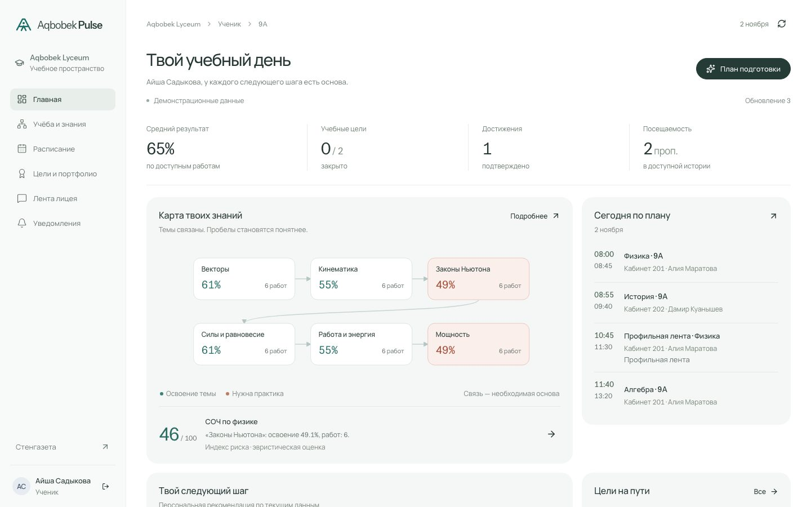
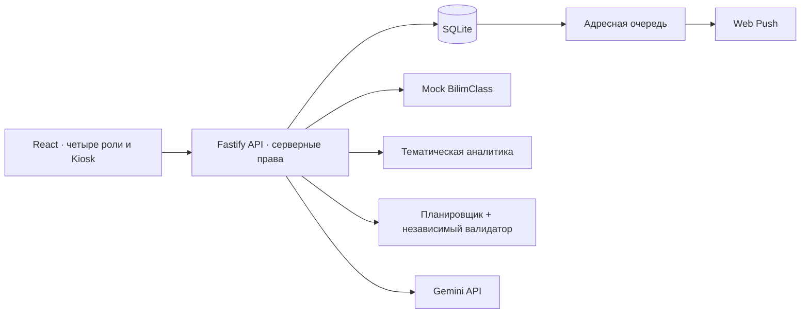

<div align="center">

# Aqbobek Pulse

**Учебные сигналы, достижения и расписание — в одном школьном портале.**

Прототип для кейса Aqbobek Lyceum · AIS Hack 3.0

[Быстрый старт](#быстрый-старт) · [Демо за 2 минуты](docs/DEMO.md) · [Описание продукта](docs/PRODUCT.md) · [Проверки](docs/VALIDATION.md)

Онлайн-демо: **TODO — публикация на Vercel** · Видео: **TODO — пока нет**

**TypeScript · React · Fastify · SQLite**

</div>



Aqbobek Pulse связывает оценки с учебными темами, помогает заметить падение успеваемости и пересчитывает расписание при отсутствии учителя. У ученика, родителя, учителя и администрации — собственные представления общих данных.

> Все данные демонстрации синтетические. Это независимый хакатонный прототип: реальная интеграция BilimClass и точность прогнозирования на школьных данных не заявляются.

## Кейс → решение

Короткие формулировки требований; исходный документ и внутренние рабочие материалы не публикуются.

| Требование кейса | Как закрываем | Где проверить |
|---|---|---|
| «ИИ анализирует массив оценок и строит граф знаний.» | Освоение тем, граф предпосылок, объяснимый индекс следующей работы | [Аналитика](server/analytics/index.ts), [проверки](tests/analytics.test.ts) |
| «Вот 3 видеолекции для подготовки» | Тьютор выбирает три материала из разрешённого каталога | [AI и валидация](server/ai/index.ts) |
| «учеников с аномальным падением успеваемости» | EWS сравнивает работы внутри одного предмета | [Аналитика](server/analytics/index.ts) |
| «Генерация текстовых отчетов об успеваемости класса» | Отчёт на разрешённых фактах через LLM API | [AI-модуль](server/ai/index.ts) |
| «Доступ к дашборду ребенка. AI-выжимка за неделю» | Серверная связь с ребёнком и семидневное окно фактов | [Проекции](server/projections.ts), [права](tests/access.test.ts) |
| «в единый верифицированный профиль» | Достижение подаётся учеником и подтверждается учителем | [API портфолио](server/app.ts) |
| «Динамические лидерборды, ачивки за закрытые учебные цели.» | Одно начисление на цель, обновляемый рейтинг дня | [Бизнес-переходы](tests/access.test.ts) |
| «Публикация событий в общую ленту с таргетингом» | Аудитория объявления фильтруется сервером | [Проекции](server/projections.ts) |
| «расписание без конфликтов» | Группы, ленты, пары, помещения, доступность и независимая проверка | [Решатель](server/schedule/index.ts), [проверки](tests/schedule.test.ts) |
| «расписание автоматически перестраивается» | Сохранение отсутствия, допустимая замена и адресная очередь | [API](server/app.ts), [уведомления](server/notifications/index.ts) |
| «Автоскролл, крупная типографика, отсутствие мыши/клавиатуры» | Самостоятельный Kiosk с анонсами, топом и заменами | [Интерфейс](client/App.tsx), [публичная проекция](server/projections.ts) |
| «Нужна реализация собственного Mock-сервера» | HTTP-маршруты оценок и посещаемости на общих данных | [Mock/API](server/app.ts), [контракты](shared/contracts.ts) |


## Быстрый старт

Нужны **Node.js 26+**, npm и доступный для записи локальный каталог. В проверенном окружении использовались Node 26.8.1 и npm 11.19.0.

```sh
npm ci
npm run build
npm start
```

После запуска: [портал — localhost:3001](http://localhost:3001) · [стенгазета — /kiosk](http://localhost:3001/kiosk).

Без API-ключа приложение работает на синтетическом mock-сервере и показывает явно помеченные фактические шаблоны. Для разработки доступен `npm run dev`.

### Демонстрационные роли

Пароль локальных демо-аккаунтов: **`Pulse2026!`**. Это открытые тестовые учётные записи, не доступ к реальной школе.

| Учётная запись | Роль |
|---|---|
| `student9@pulse.demo` | Ученик 9-го класса |
| `student10@pulse.demo` | Ученик 10-го класса |
| `teacher@pulse.demo` | Учитель |
| `substitute@pulse.demo` | Заменяющий учитель |
| `parent@pulse.demo` | Родитель |
| `admin@pulse.demo` | Администрация |

Ограничения доступа применяются на сервере: родитель видит связанного ребёнка, учитель — назначенные классы и предметы.

### Настройка AI

Создайте локальный `.env` по образцу [.env.example](.env.example). Значения секретов в репозитории отсутствуют.

| Переменная | Назначение |
|---|---|
| `GEMINI_API_KEY` | Ключ Gemini API, только на сервере |
| `GEMINI_MODEL` | Модель, доступная вашему аккаунту |
| `PORT` / `HOST` | Адрес сервера; по умолчанию `3001` / `127.0.0.1` |
| `APP_ORIGIN` | Точный origin приложения; для удалённого размещения нужен HTTPS |
| `DATABASE_PATH` | Необязательный путь SQLite; по умолчанию `data/pulse.sqlite` |

После изменения конфигурации перезапустите сервер. Текстовый ответ помечается как `live`, `cache` или `fallback`; недоступность AI не скрывается за заранее записанным ответом.

## Как посмотреть за 2 минуты

1. **Ученик:** откройте карту тем, объяснение риска и план подготовки; закройте учебную цель.
2. **Учитель:** посмотрите ранние сигналы и отчёт класса; подтвердите добавленное учеником достижение.
3. **Родитель:** откройте данные своего ребёнка и недельную выжимку.
4. **Администрация:** в расписании отметьте отсутствие учителя — система ищет допустимую замену и публикует новую версию.
5. **Стенгазета:** откройте `/kiosk` — актуальные замены, анонсы и топ дня обновляются автоматически.

[Подробный сценарий и настройка уведомлений →](docs/DEMO.md)

<details>
<summary>Расписание после автоматической замены</summary>


</details>

## Архитектура



Один сервер обслуживает интерфейс и API. SQLite сохраняет состояние между запусками. Публикация расписания и адресные события выполняются атомарно; доставка происходит после сохранения.

## AI и собственные алгоритмы

Провайдер — **Gemini API**; реальными запросами проверена `gemini-3-flash-preview`. Конкретная модель задаётся через `GEMINI_MODEL`. Адаптер использует JSON Schema и проверяет результат на сервере; выбор не сопровождается заявлением о сравнительном превосходстве модели.

[Промпт, JSON-схема и проверка ответа](server/ai/index.ts) · [Типы и схемы запросов](shared/contracts.ts)

- Собственный алгоритм рассчитывает освоение тем, индекс риска и ранние сигналы; LLM формирует объяснения и отчёты на основании вычисленных фактов.
- Планировщик учитывает людей, помещения, длительность и синхронные группы. Независимый валидатор проверяет результат перед публикацией.
- AI-ответ проверяется по схеме и допустимым ID фактов/материалов. При ошибке используется помеченный шаблон, при повторном запросе — кэш по роли и версии данных.
- Индекс риска **не является калиброванной вероятностью**. Оценка качества на реальных школьных данных ещё не проводилась.

## Метрики и границы доказательств

Локальный набор: **24 синтетических ученика, 1296 оценок, 15 назначений**. Замер на Node26.8.1:10прогревочных и100измеряемых запусков каждой операции; сетевые запросы и LLM в тайминги не входят.

| Операция | p50 | p95 | Объём |
|---|---:|---:|---|
| Аналитика одного ученика | 0.249 мс | 0.381 мс | 100 прогонов |
| Генерация расписания | 0.972 мс | 1.255 мс | 100 прогонов |
| Перестроение после отсутствия | 0.802 мс | 0.933 мс | 100 прогонов |

Воспроизвести: `npm run benchmark`. Каждый результат расписания дополнительно проходит валидатор. [Методика](docs/VALIDATION.md).

| Качество / стоимость AI | Статус |
|---|---|
| Контрольные истории риска | 12/12 проходят; это заданные синтетические случаи, не независимый школьный тест |
| Accuracy / F1 на реальных исходах СОЧ | **TODO:** разрешённый размеченный датасет отсутствует |
| Задержка внешнего LLM p50/p95 | **TODO:** серия измерений не проведена |
| Цена AI-запроса и месяц работы школы | **TODO:** тариф, реальные токены и число пользователей не зафиксированы |

Для пилота стоимость считается по фактическим входным/выходным токенам и выбранному тарифу, отдельно добавляется хостинг. Масштаб лицея неизвестен; расчёт на вымышленное число учеников не приводится. Внутренние тесты и benchmark не вызывают внешний LLM.

## Проверки

```sh
npm run check
npm run smoke
```

`check` выполняет сборку, проверку TypeScript и тесты. Для `smoke` сервер должен быть запущен на localhost:3001.

| Проверка | Подтверждённый результат |
|---|---|
| Автоматические тесты | **49 / 49**, без пропущенных тестов |
| Учётные записи | Шесть входов, четыре роли |
| Браузерный сценарий | Цели, портфолио, подтверждение, замена учителя, таргетированная лента и Kiosk |
| Адаптивность | Проверены ширины 1440, 768 и 390 px |
| Настоящий LLM API | Проверены тьютор, отчёт класса и недельная сводка |
| Прогнозная точность на школе | Не измерялась; синтетические сценарии проверяют поведение алгоритма |
| Доставка системного Web Push | Реализована; получение двумя обычными браузерными профилями требует проверки |

[Методика и границы проверки →](docs/VALIDATION.md)

## Структура

```text
client/                 интерфейс и ролевые экраны
server/analytics/       тематическая аналитика
server/schedule/        поиск расписания и валидатор
server/ai/              адаптер модели и проверка ответов
server/notifications/   очередь доставки
shared/                 типы и схемы контрактов
tests/                  алгоритмические и интеграционные тесты
fixtures/               синтетические проверочные сценарии
docs/                   инструкции и скриншоты
```

## Границы прототипа

Начальный масштаб — **24 синтетических ученика, четыре класса и один день расписания**. Публичного хостинга и подключения к реальному BilimClass пока нет. Для внедрения потребуются официальный контракт данных, согласованные школьные правила расписания, проверка прав доступа и пилот на разрешённых обезличенных данных.

[Полный перечень ограничений →](docs/LIMITATIONS.md)

## Команда и следующий шаг

Автор проекта — [Taveer09](https://github.com/Taveer09), один участник. Зоны работы: интерфейс, сервер, алгоритмы и проверка сквозного сценария.

Для пилота у заказчика: согласовать контракт данных и правила расписания, подключить постоянное хранилище, проверить права и Web Push на реальных устройствах, затем измерить качество на разрешённых обезличенных данных. Разработка интерфейса и локальная проверка не выдаются за внедрение в школе.
